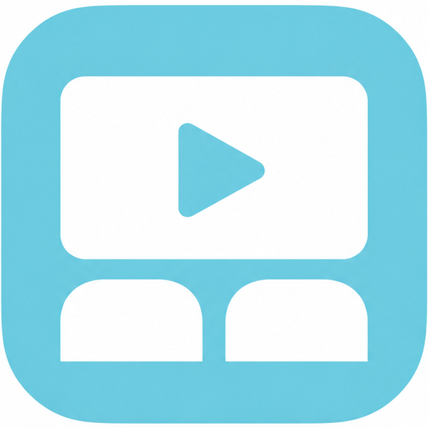

# BiliCinema

BiliCinema 提供 Windows 桌面端和 Android 客户端，可以播放哔哩哔哩视频、与好友同步观影。Windows 下载功能基于 [DownKyi Core](https://github.com/crazysmile-PhD/downkyicore)。每个房间最多 **5 人（1 位房主 + 4 位访客）**，房间服务运行在 Cloudflare。

支持 **多人在各自电脑上登录同一个 B 站账号**，进入同一房间同步观看，也可以各自使用不同账号。

## 下载

前往 [GitHub Releases](https://github.com/LeonZ03/BiliCinema/releases)，下载最新版本中的 `BiliCinema-<版本>-win-x64.exe`，保存到电脑后双击运行。程序以 Windows x64 单文件形式发布，不需要另外安装 .NET。播放视频需要安装 Microsoft Edge WebView2 Runtime；大多数 Windows 电脑已自带该组件。

首次启动需要解压内置组件，请稍候；登录和下载数据默认保存在 `%APPDATA%\DownKyi`。

Android 8 及以上设备下载同一 Release 的 `BiliCinema-<版本>-android-universal.apk`，使用系统安装器安装；播放依赖 Android System WebView。安卓端提供登录、观影、房间和聊天，不包含 Windows 下载器。手机与平板应在实际网络中验证 B 站登录和内容权限，见 [Android 说明](android/README.md)。

两个客户端均检查本仓库的新版本并提示更新。Windows 下载并校验后保存任务、退出和替换程序，保留旧版以供恢复；Android 校验安装包和签名后打开系统安装器，需要用户确认安装。更新失败会保留现有版本。Windows 1.5.0 及更早版本需手动升级至 1.5.1，之后支持带版本号安装包的应用内更新。

## 快速开始

1. **登录**：打开“登录”页，用哔哩哔哩 App 扫描页面上的二维码并确认。也可以点“复制二维码图片”，把图片私下发给可信任的协助者扫码。
2. **播放视频**：打开“观影房间”页，粘贴 B 站番剧、电影或普通视频链接。解析完成后即可在视频内操作；不创建房间也可以单人观看。
3. **邀请一起观看**：播放页点击“创建房间”，把同一个固定域名邀请链接发给最多 4 位好友。Windows 和 Android 都直接连接云端房间，可以先建空房再选片；不需要常开电脑或启动 Tunnel。房主离线超过重连窗口后房间会结束。
4. **同步与聊天**：房主控制选片、选集、播放、暂停、跳转和倍速，所有访客跟随。解析后自动同步实际进度；点击 **↻** 图标可检查播放器，在房间内还会手动同步进度。单人观看时也可使用。每个人各自从 B 站播放，画质和音量各自设置。
5. **下载影片**：打开“下载影片”页，解析视频或番剧后选择可用的清晰度、编码和音质，再添加下载任务。页面会显示预计大小；下载功能沿用 DownKyi 的下载器和断点续传能力。

更详细的操作方式、加入房间后的播放行为和同步说明见[观影使用说明](docs/watch-together.md)。

## 观看与聊天

- **F** 进入或退出全屏，**D** 开关弹幕；聊天输入期间暂停播放快捷键。
- 窗口和全屏都可将鼠标移到视频右边缘呼出聊天。未输入时移出面板后延迟收起；输入期间保持展开，按 **Alt** 收起并保留草稿。Enter 发送，Shift+Enter 换行；新消息在画面右侧显示 5 秒。
- “我的昵称”会记住上次保存的内容，不公开 B 站账号信息。
- 房间最多 **5 人，包含房主**；满员时会提示加入失败。所有成员请使用同一版本。
- 新成员加入或有人缓冲时，会等待在线成员准备好再同步播放。访客断线不阻塞其他人；房主离线 2 分钟后云端结束房间。单个房间最长保留 24 小时。
- 播放权限取决于各自登录的 B 站账号；会员内容需要相应权限。

## 开发者入口

需要构建或维护项目时，可从以下文档开始：

- [架构与模块边界](ARCHITECTURE.md)
- [Agent 修改指南](AGENTS.md)
- [维护文档](docs/maintenance.md)
- [测试说明](docs/testing/README.md)
- [验证与回滚](docs/operations/verification-and-rollback.md)
- [云端房间部署](cloud/DEPLOYMENT.md)
- [构建脚本](build-windows.cmd)

Windows x64 开发电脑可运行 `build-windows.cmd` 构建单文件程序；构建需要 .NET 10 SDK。源码也可通过 `dotnet run --project DownKyi/DownKyi.csproj` 运行。

Windows 和 Android 安装包统一输出到 `artifacts/releases/<版本>/<平台>/`，各自附带 `SHA256SUMS.txt`。构建中间文件位于 `artifacts/publish/`。版本只修改根目录 `version.txt`；普通脚本和文档使用小写短横线命名，.NET 项目、类型及标准入口文件保留各自平台约定。

## 项目与许可

DownKyi 默认数据目录为 `%APPDATA%\DownKyi`，可设置 `DOWNKYI_DATA_DIR` 指定其他目录。BiliCinema 基于 DownKyi Core 开发；许可和第三方组件归属见 [LICENSE](LICENSE) 与 [THIRD-PARTY-NOTICES.md](THIRD-PARTY-NOTICES.md)。
